# ✦ Digesteer — QQ 智能消息筛选与 AI 深度日报桌面助手

<p align="center">
  <strong>与官方桌面 QQ 同号共存运行 · 增量时间锚点去重 · 多模态识图 · Apple HIG × Designeer.xyz 沉浸式研报工作台</strong>
</p>

<p align="center">
  
  
  
  
</p>

---

## 📖 项目简介

面对数十个高活跃度的课程通知群、学科竞赛群、科研实验室群与技术交流群，每天动辄数千条群聊消息极易淹没关键的**作业 DDL、课件上传、奖学金通知、竞赛动态与高价值 AI/工程技术讨论**。

**Digesteer (`QQ智能日报助手`)** 是一款专为高密度群聊场景打造的 **Windows 原生独立桌面软件**：
- **官方 QQ 同号有头共存**：无需牺牲日常聊天体验，官方桌面 QQ 与本软件同账号同时在线运行，日常聊天用官方 QQ，集中阅读与待办执行用本软件。
- **离线/漫游消息自动回溯补齐**：即使软件关闭数小时或隔夜再打开，也会主动向 QQ 客户端拉取自上次总结时间锚点以来的全部群聊历史，确保 **0 漏收**。
- **增量时间水印（Watermark）机制**：每期日报生成后自动为当批消息打上精确的时间标记归档，后续生成日报**只总结新增消息，绝不重复总结第二遍**。
- **100% 原汁原味零截断 + AI 多模态识图**：本地 L1 规则自动剔除纯表情包、水群复读与本人发言，对群内截图/通知海报实时调用多模态视觉模型提取文字与画面信息，将 100% 零截断记录送入长上下文大模型通盘提炼。
- **Apple HIG × Designeer.xyz 沉浸式工作台**：支持左侧章节目录大纲快速跳转、所见即所得（WYSIWYG）深度简报、待办清单实时完成进度条，以及**简报内联一键溯源上下文并直接回复**。

---

## 🏗️ 系统架构

```mermaid
flowchart LR
    subgraph Desktop["1. 同号共存采集层 (Windows 桌面)"]
        QQ["官方桌面 NTQQ 客户端"] <-->|NapCat Framework 有头共存| WS["OneBot v11 WebSocket (3001)"]
        WS -->|实时消息流 + 漫游历史回溯| Sync["消息同步与去重引擎"]
    end

    subgraph Storage["2. 本地降噪与增量水印层"]
        Sync --> L1["L1 规则过滤<br/>(剔除纯表情包/复读/本人发言)"]
        L1 --> Vision["多模态 AI 视觉识图<br/>(提取通知海报/代码截图内容)"]
        Vision --> DB[("Node.js 原生 SQLite<br/>含增量时间水印 Watermark")]
    end

    subgraph AIEngine["3. 远程大模型深度提炼层"]
        DB -->|仅提取上次水印后新增有效消息| Prompt["100% 零截断全量上下文组装<br/>(强制北京时间 UTC+8 校准)"]
        Prompt --> LLM["OpenAI 兼容远程大模型 API<br/>(DeepSeek / Gemini / Qwen / GPT)"]
        LLM --> Parser["三重防崩结构化解析器<br/>(JSON 强约束 + 自动修复 + Markdown 兜底)"]
    end

    subgraph StudioUI["4. 原生桌面交互层 (QQ智能日报助手.exe)"]
        Parser --> WyReport["📖 所见即所得深度简报<br/>(带章节目录与待办进度条)"]
        Parser --> Cards["🗂️ 四维策展灵感卡片<br/>(必看通知 / 学科竞赛 / AI干货 / 讨论)"]
        WyReport <-->|🔍 议题旁一键溯源并直接回复| Trace["右侧毛玻璃原群上下文抽屉"]
        Cards <--> Trace
    end
```



---

## ✨ 核心特性

### 1. 💬 与官方桌面 QQ 完美同号共存
- 采用 `NapCat.Framework` 有头注入桥接方案，双击 [`QQ智能日报助手.exe`](./QQ智能日报助手.exe) 即可在后台静默完成环境自检，并与官方原生桌面 QQ 同时在线运行。
- 全程 **0 终端黑框（Zero CMD Windows）**，支持最小化至 Windows 系统托盘常驻及单实例唤醒。

### 2. ⏱️ 增量时间锚点（永不重复总结）+ 漫游防漏收
- **时间水印标记**：数据库中每条消息均维护 `summarized_at` 与 `summarized_digest_id` 字段。生成日报后自动推进时间锚点，确保已读历史绝不二次消耗 Token 或干扰视线。
- **主动回溯同步**：内置 `backfillRecentGroupHistory` 漫游补齐机制，启动时、生成日报前或点击顶部 **`🔄 同步消息`** 按钮时，自动扫描所有活跃群聊补齐离线期间的漏收消息。

### 3. 🖼️ 原汁原味长上下文 + 多模态图片理解
- 摒弃机械截断，将群聊消息 100% 原汁原味（含群主/管理员身份标签、引用关系、中国标准时间 `UTC+8` 时间戳）送入大模型。
- 当群友发送通知长图、讲座海报、报错截图或电路图时，自动通过多模态视觉接口提取图中关键文字并嵌入消息流参与总结。

### 4. 🍎 Apple HIG × Designeer.xyz 桌面级阅读与溯源体验
- **无嵌套滚动条的双栏布局**：左侧可折叠目录大纲（支持一键跳转到 `🧭 全局深度导读`、`✅ 集中待办清单`、`🚨 必看通知`、`🏆 学科竞赛`、`🤖 AI 与技术干货`、`💬 热门讨论` 及切换历史期数），右侧单一顺滑滚动阅读区。
- **简报内联一键溯源**：在所见即所得（WYSIWYG）总简报的每一个具体议题和待办旁，直接内嵌 **`🔍 溯源并回复`** 按钮，边读简报即可随时点开右侧抽屉查看当时原群聊天上下文并直接打字回复。
- **待办清单进度追踪**：自动计算待办完成百分比进度条，支持一键隐藏已完成事项、一键复制未完成待办与完整 Markdown 报告。
- **多视图与多主题**：支持 `◫ 研报+卡片` / `📖 沉浸研报` / `🗂️ 灵感卡片` 三种视图切换，`Aa 标准 / 大字 / 超大` 三档字号，以及 **Apple 深空黑 / Cupertino 暖白纸张**双主题切换。

---

## 📂 项目目录结构

```text
├── launcher/
│   └── Program.cs              # C# WinForms + WebView2 原生桌面宿主源码 (单实例锁/深色标题栏/系统托盘/零黑框进程守护)
├── src/
│   ├── index.ts                # 后端服务入口、共存版 QQ 自动检测与每日定时调度器
│   ├── server.ts               # HTTP API 服务、WebSocket 挂载与日报生成编排
│   ├── napcat.ts               # OneBot v11 正反向客户端、漫游历史消息回溯补齐与实时收发接口
│   ├── filter.ts               # L1 本地规则降噪过滤器 (表情包/复读机/本人发言过滤 & 高优关键词提权)
│   ├── ai.ts                   # 多模态图片识别、UTC+8 时区校准、长上下文提示词工程与三重防崩解析器
│   ├── db.ts                   # 基于 Node.js 原生 node:sqlite 的持久化存储与增量时间水印管理
│   ├── ui-template.ts          # Apple HIG × Designeer.xyz 风格桌面端前端工作台
│   ├── notifier.ts             # 手机端高优消息强提醒推送 (支持 Bark / 飞书 / PushPlus)
│   ├── config.ts               # 配置文件读写管理
│   └── types.ts                # TypeScript 核心类型定义
├── QQ智能日报助手.exe           # 编译打包好的 Windows 原生独立桌面端主程序
├── .env.example                # 环境变量配置示例
├── package.json                # 项目依赖与构建脚本
└── tsconfig.json               # TypeScript 编译配置
```

---

## 🚀 快速开始

### 1. 环境要求
- **操作系统**：Windows 10 / 11 (x64)
- **运行环境**：Node.js `>= 22.5.0`（推荐 `v24.x`，内置原生 `node:sqlite`）
- **桌面运行库**：Windows 11 自带 Microsoft Edge WebView2 Runtime

### 2. 安装依赖
```bash
npm install
```

### 3. 启动方式

#### 方式 A：直接运行原生桌面软件（推荐）
直接双击项目根目录下的 **[`QQ智能日报助手.exe`](./QQ智能日报助手.exe)**：
1. 程序会自动在后台静默启动本地服务与 AI 网关（全程无黑框）；
2. 若官方 QQ 尚未以共存模式运行，点击右上角 **`💬 官方 QQ`** 即可拉起共存版官方桌面 QQ；
3. 在 **`⚙️ 引擎与设置`** 页签中填入您的远程大模型 API Key（支持 DeepSeek、硅基流动、通义千问、Google Gemini、OpenAI 等任意兼容接口），点击 **`✦ 总结新增消息`** 即可生成深度日报。

#### 方式 B：开发调试模式
```bash
# 启动开发热更新服务
npm run dev

# 重新编译打包原生桌面程序 QQ智能日报助手.exe
npm run build:exe
```

---

## ⌨️ 快捷键一览

| 快捷键 | 功能说明 |
| :---: | :--- |
| `1` | 切换至 **📅 智能日报** 工作台 |
| `2` | 切换至 **🌊 实时降噪流** |
| `3` | 切换至 **🗂️ 群聊订阅与权重** |
| `4` | 切换至 **⚙️ 引擎与设置** |
| `[` | 展开 / 收起左侧章节目录与期数侧边栏 |
| `Esc` | 关闭右侧原群上下文溯源抽屉或确认框 |

---

## 📄 License

MIT License © [gaoyingao](https://github.com/gaoyingao)
